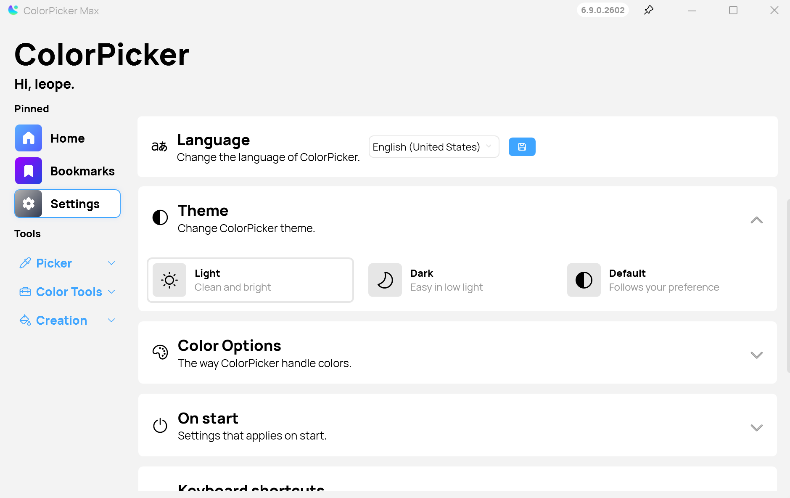

A new version of ColorPicker Max is now available with new features, improvements, and bug fixes to enhance your
experience with the app. Please note that this should be the last major feature version of ColorPicker Max 6.x, as we
will be focusing on the development of ColorPicker Max 7 later this year.

## What's New in This Update

- New dark theme: We've added a new dark theme to the app, allowing you to choose the theme that best suits your
  preferences and environment.
- New theme picker: We've added a new theme picker to the app, making it easier to switch between themes and customize
  the app's appearance to your liking.
- Improved performances of Image Extractor: We've optimized the Image Extractor feature to improve its performance,
  allowing you to extract colors from images more quickly and efficiently.

## Changelog

### New

- Add new dark theme (#474)
- Add new theme picker (#476)

### Fixed

- Improve performances of Image Extractor (#450)
- Carret not visible in dark mode (#473)
- Improve memory usage of Image Extractor

### Updated

- Upgrade to .NET 10 (#475)

## Download

[Click here](https://tinyurl.com/DownloadColorPickerMax) to download ColorPicker Max.

[Learn More](https://leocorporation.dev/store/colorpickermax) about ColorPicker Max.
