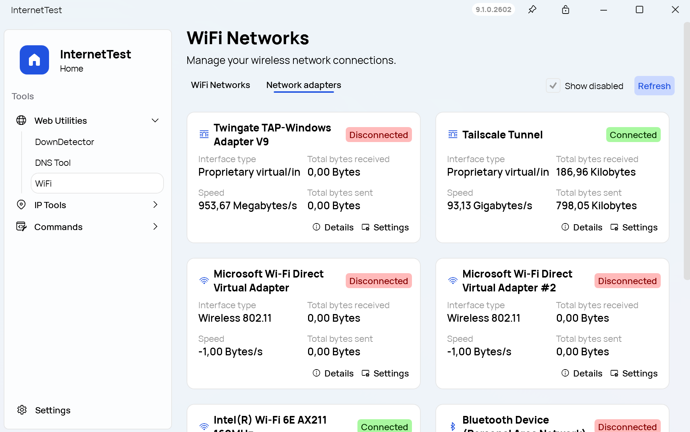

Version 9.1.0.2602 of InternetTest Pro is now available! This update includes new features, improvements, and bug fixes to enhance your experience with the app.

## What's New in This Update

- More interface types: We've added more interface types to the app, allowing you to view more details about your network interfaces.
- Disabled style for Button: We've added a disabled style to the Button control, making it easier to identify when a button is not clickable.
- New design for "Status" pill: We've redesigned the "Status" pill to make it more visually appealing and easier to read.
- .NET 10 as a required dependency: InternetTest Pro now requires .NET 10 to run, ensuring that you have the latest features and improvements from the .NET Framework.

## Changelog

### New

- Add more interface types (#693)
- Add disabled style to Button (#694)
- Add new design for "Status" pill (#695)
- Add .NET 10 as a required dependency (#696)

### Updated

- Update to .NET 10 (#696)
- Update Licenses (#697)

## Website

InternetTest Pro has a landing page so you can learn more about its
feature. [Click here](https://leocorporation.dev/store/internettest) to access it.

## Get the app

InternetTest Pro is available on Windows and requires the .NET 8 Windows Desktop Runtime.

- [Click here](https://tinyurl.com/DownloadITP7) to get the **Setup** version of InternetTest Pro
- [Click here](https://tinyurl.com/DownloadITPP) to get the **Portable** version of InternetTest Pro
